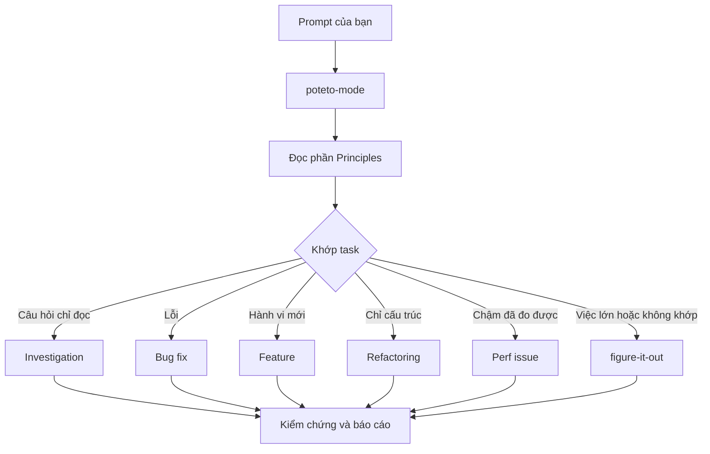

# Chuyển công việc qua `/poteto-mode`

`/poteto-mode` là cửa chính. Bạn đưa cho nó một mục tiêu, nó khớp với một trong hai mươi hai playbook, chép các bước của playbook đó vào todo list, và gọi các skill khác khi các bước cần đến. Trong trang này bạn học một prompt tốt trông thế nào, và bạn thật ra cần ít đến mức nào.


## Điều gì xảy ra với prompt của bạn



Sơ đồ cho thấy các đường đi phổ biến. Ngoài ra còn có playbook cho hillclimb một chỉ số, chẩn đoán triệu chứng runtime và trace đã thu, prototype, visual parity, viết và đánh giá skill, autonomous run, mở PR, babysit một PR hoặc stack đến khi sẵn sàng merge, ship một stack đã kiểm chứng, chạy một hàng đợi PR hoặc một stack ở chế độ autopilot, session pickup, tạm dừng an toàn, kế hoạch nhiều giai đoạn, và dọn worktree. [Thư mục playbook](../../skills/poteto-mode/playbooks/) có bộ đầy đủ.

## Nói mục tiêu, không cần nghi thức

Bạn không viết spec. Bạn nói cái gì đang sai hoặc bạn muốn gì, cộng với bất cứ điều gì bạn đã biết giúp agent tiết kiệm thời gian:

```text
/poteto-mode người dùng nhận hai thông báo sau một lần retry. tái hiện trước, rồi sửa và kiểm chứng.
```

Đó là một prompt Bug fix. "tái hiện trước" là một ràng buộc thật, không phải phép lịch sự, và playbook tôn trọng nó. Hãy xem todo list được điền các bước của Bug fix.

## Prompt nên chứa gì

Một prompt hữu ích chứa tối đa năm thứ, và mỗi thứ gói gọn trong một câu:

- **Mục tiêu.** Nói cái gì đang sai, hoặc bạn muốn gì.
- **Cách kiểm tra đã xong.** Nó phải có thể pass hoặc fail. "Làm cho nó tốt hơn" và "làm trong một tiếng" không phải là cách kiểm tra.
- **Bằng chứng bạn muốn thấy.** Yêu cầu output thật của lệnh, video của luồng thao tác, giá trị được lưu, hoặc con số trước và sau.
- **Những gì bạn đã biết.** Một triệu chứng, một bước tái hiện, một dòng log, hoặc một link giúp agent đỡ phải tìm kiếm.
- **Các ràng buộc thật.** "tái hiện trước", "chưa thay đổi code nào", "không thay đổi hành vi", và "để tôi review trước khi làm tiếp" mỗi cái đều thay đổi việc agent làm.

Đây là một prompt có đủ cả năm:

```text
/poteto-mode từ lần deploy hôm qua, export csv bị mất dòng cuối. id của job lỗi là 4812. tái hiện trước, rồi sửa. xong nghĩa là fixture 60k dòng export đủ mọi dòng. cho tôi xem số dòng trước và sau.
```

Có hai thứ nên bỏ ra:

- **Cách làm.** Nói điều cần đạt được, và chừa chỗ cho agent tìm một con đường tốt hơn con đường bạn sẽ chọn. Điều tương tự áp dụng cho danh sách skill, được nói trong phần cạm bẫy bên dưới.
- **Giả thuyết của bạn về nguyên nhân, lúc đầu.** Một phỏng đoán được nói ra sẽ thu hẹp việc tìm kiếm vào chỗ bạn đã chỉ. Hãy để agent nhắc lại vấn đề trước khi bạn chia sẻ linh cảm của mình.

Với một báo cáo nhiều nhiễu, như một thread dài hay một bug mơ hồ, hãy biến việc nhắc lại thành bước đầu tiên:

```text
/poteto-mode đọc thread này. nhắc lại vấn đề cốt lõi bằng lời của bạn, bằng tiếng việt dễ hiểu. chưa thay đổi code nào.
```

Một sự hiểu sai sẽ lộ ra trong phần nhắc lại, trước khi có bất kỳ dòng code nào. Sửa nó ở đó, và bạn chỉ tốn một tin nhắn thay vì một bản sửa sai. Nếu chỉ cần phần nhắc lại, không cần playbook, hãy chạy [`/in-your-own-words`](../../skills/in-your-own-words/SKILL.md). Nó nhắc lại những gì agent nghĩ là mục tiêu của bạn và vấn đề bạn đang cố giải quyết.

Khi bạn không chắc một prompt đã nhắm đúng chưa, hãy chạy [`/sharpen`](../../skills/sharpen/SKILL.md) trên nó trước khi gửi:

```text
/sharpen viết hướng dẫn migration cho định dạng config v2.
```

Agent nói điều một chuyên gia hàng đầu sẽ làm mà bạn chưa yêu cầu, nguyên liệu thô nhất họ sẽ bắt đầu từ đó, các phương pháp và công cụ họ sẽ dùng, và thứ gì ngoài bạn hay agent sẽ cho thấy kết quả là đúng. Rồi nó viết lại prompt của bạn để yêu cầu chính xác điều đó, sâu hơn nhưng không dài hơn. Bản viết lại yêu cầu agent prototype mọi lựa chọn mà một thí nghiệm có thể giải quyết và đề xuất một phương án từ những gì nó quan sát được, và để các lựa chọn về sản phẩm và sở thích cho bạn. Nó không làm task. Đọc bản viết lại, rồi gửi nó, ví dụ với `/poteto-mode`.

Khi bạn không gọi tên được thứ mình đang tìm, hãy chạy [`/reframe`](../../skills/reframe/SKILL.md) trên mô tả và các file của chính bạn trước:

```text
/reframe trang settings lưu ngay một số trường còn số khác chỉ lưu khi submit, và người dùng bị mất chỉnh sửa.
```

Agent đưa ra 8 đến 12 thuật ngữ chuyên môn, xếp theo mức độ mỗi thuật ngữ sẽ thay đổi thứ bạn xây. Mỗi thuật ngữ đi kèm phần mô tả của bạn mà nó gọi tên, một dự án thật dùng nó, có link đã được kiểm tra, và điều nó cho phép bạn yêu cầu agent. Nó cũng mượn thuật ngữ từ 2 hoặc 3 lĩnh vực lân cận đã giải cùng vấn đề dưới tên khác, và nói rõ mỗi phép so sánh sai ở đâu. Rồi nó viết lại mô tả của bạn bằng những từ mới. Gửi bản viết lại, hoặc chạy `/sharpen` trên nó.

## Tin nhắn tiếp theo thật ngắn

Khi cuộc trò chuyện đã mang context, prompt co lại gần như không còn gì. Tất cả những câu này là đủ:

```text
/poteto-mode làm đi
```

```text
tiếp tục
```

```text
cứ làm tiếp đến khi xong
```

Ngắn vẫn hiệu quả vì playbook giữ cấu trúc, và Custom Mode giữ `/poteto-mode` trong context mọi lượt. [Cài đặt pstack](./01-setup.md#chạy-task-đầu-tiên) chỉ cách bật nó. Lời của bạn mang ý định, còn skill mang sự chặt chẽ.

## Đổi task bằng "task mới"

Một chat dài tích lũy context từ task trước. Khi bạn đổi chủ đề, hãy nói ra:

```text
/poteto-mode task mới. tìm hiểu tại sao cache entry vẫn còn sau khi logout. chưa thay đổi code nào.
```

"task mới" báo cho `/poteto-mode` khớp lại từ đầu thay vì tiếp tục playbook trước. "chưa thay đổi code nào" ghim task này vào Investigation. Không có hai cụm từ đó, một mode đang giữa chừng Feature có xu hướng coi câu hỏi của bạn là bước feature tiếp theo.

## Cho công việc song song một máy riêng

Nếu bạn chạy nhiều agent trên một repository trong một máy tính, chúng sẽ tranh giành working tree, cổng mạng và output build. Cách cô lập gọn nhất là một [cloud subagent](https://cursor.com/docs/subagents#cloud-subagents). Mỗi cái có VM và branch riêng, nên nó có thể cài dependency, chạy ứng dụng của bạn, và quay video kết quả mà không đụng đến máy của bạn. Gõ `/in-cloud` trước task, hoặc yêu cầu chat cha giao việc cho cloud subagent.

Khi công việc phải ở cục bộ, hãy yêu cầu một worktree ngay từ đầu:

```text
/poteto-mode task mới. tách branch từ <base> trong một worktree mới, rồi port thay đổi parser sang đó.
```

Mỗi task có branch và worktree riêng nghĩa là không agent nào giẫm lên file của agent khác. Worktree tốn dung lượng đĩa và tài nguyên máy, nên một laptop chỉ chạy được vài cái cùng lúc. [Playbook Opening a PR](../../skills/poteto-mode/playbooks/opening-a-pr.md) vốn đã làm việc từ một worktree cho các thay đổi code, nên phần lớn bạn chỉ nói điều này khi một base hay vị trí cụ thể là quan trọng.

Worktree tích tụ dần. Khi đĩa sắp đầy, hãy hỏi:

```text
/poteto-mode cái gì đang ngốn đĩa của tôi? dọn các worktree an toàn để dọn.
```

[Playbook Worktree cleanup](../../skills/poteto-mode/playbooks/worktree-cleanup.md) phân loại mọi worktree theo trạng thái merge, công việc chưa commit, và những chat nào vẫn còn đụng đến nó. Nó chỉ xóa những gì bằng chứng đó cho phép và dừng lại chờ bạn quyết với bất cứ thứ gì còn giữ công việc chưa commit.

## Để nó tự chạy

Khi bạn rời đi, hãy nói xong nghĩa là gì rồi đi:

```text
/poteto-mode tôi đi vắng một lúc. cứ làm tiếp đến khi migration check báo không còn caller cũ nào. ghi lại các quyết định của bạn.
```

Công việc bạn sẽ review sau được chuyển qua [`/figure-it-out`](../../skills/figure-it-out/SKILL.md), skill này thiết kế các giai đoạn của lần chạy và giữ một nhật ký quyết định [`/show-me-your-work`](../../skills/show-me-your-work/SKILL.md). [Chạy công việc trong khi bạn ngủ](./07-overnight.md) đề cập đầy đủ hợp đồng chạy qua đêm.

**Cạm bẫy:** đừng liệt kê skill trong prompt ("dùng /architect, rồi /arena, rồi /interrogate..."). Playbook đã sắp thứ tự chúng, và một chuỗi viết tay thường đảo thứ tự hoặc bỏ sót các bước mà playbook lẽ ra đã giữ. Chỉ gọi tên một skill khi bạn muốn ghi đè một lựa chọn cụ thể.

Đọc chính [`poteto-mode`](../../skills/poteto-mode/SKILL.md) để biết đầy đủ các quy tắc định tuyến.

Tiếp theo: [Hiểu code](./03-understand.md).
