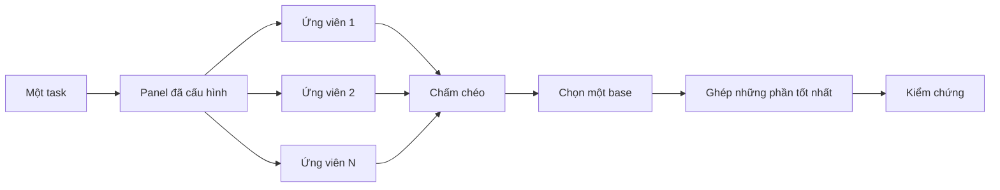

# Thiết kế trước khi viết code

Một lần thử duy nhất cho một thiết kế khó sẽ khóa chặt hình dạng đầu tiên mà model nghĩ ra. `/architect` chốt các type và ranh giới trước khi cài đặt. `/arena` chạy nhiều lần thử với cùng một brief và hợp nhất những phần tốt nhất. `/interrogate` để các model khác cố phá kết quả. Khi công việc là độ bao phủ thay vì tổng hợp thiết kế, `/swarm` tỏa ra các lát cắt hoặc các cuộc đua và gộp kết quả của chúng.

Hai sai lầm thiết kế phổ biến nhất là nhận thiết kế đầu tiên của agent và trau chuốt một kế hoạch chưa có dòng code nào kiểm thử. Trang này sửa cả hai. Bạn lập kế hoạch thông qua code. Prototype trả lời các câu hỏi còn mở, một README hoặc tutorial đặt ra mục tiêu, và kế hoạch viết ra đến sau cùng.


## Chốt hình dạng với `/architect`

```text
/architect thiết kế import pipeline trước khi viết bất kỳ code nào. tôi quan tâm nhất đến cách caller dùng nó.
```

[`/architect`](../../skills/architect/SKILL.md) lần theo mọi hệ thống mà thay đổi đụng đến trước tiên. Rồi nó phác thảo hai hình dạng khác nhau, mỗi cái có type, signature và ranh giới module, và chọn cái mà mỗi phần state chỉ có một chủ sở hữu, mỗi việc chỉ có một cách làm, và caller cần biết ít nhất. Với một thiết kế lớn hoặc gây tranh cãi, nó chạy `/arena` thay vì phác thảo một mình. Nếu bạn muốn xem thiết kế trước khi có code, hãy nói vậy trong prompt.

Thiết kế không bất khả xâm phạm khi code đã bắt đầu. Nếu cùng một cách lách cứ quay lại, `/architect` thiết kế lại thay vì vá xung quanh nó.

## Tỏa ra nhiều lần thử với `/arena`

```text
/arena đưa nguyên văn prompt của tôi lên arena. tôi muốn so sánh đề xuất của chúng với của bạn.
```

[`/arena`](../../skills/arena/SKILL.md) là công cụ tổng quát nằm bên dưới. N subagent thử cùng một brief thiết kế hoặc code song song, mỗi cái ghi vào worktree hoặc thư mục riêng. Một giám khảo chỉ đọc từ một nhà cung cấp model khác chấm điểm mọi ứng viên theo một rubric. Khi không có model nào từ nhà cung cấp khác chạy được, coordinator bỏ qua giám khảo và tự chọn base. Coordinator đọc từng ứng viên từ đầu đến cuối, chọn một base, ghép vào những ý tưởng hay nhất từ các ứng viên thua, và kiểm chứng kết quả.



Panel đến từ cấu hình [`/setup-pstack`](../../skills/setup-pstack/SKILL.md) của bạn, và bạn có thể điều chỉnh nó theo từng task. Yêu cầu nhiều ứng viên hơn khi quyết định quan trọng, ít hơn khi không:

```text
/arena việc này, 5 ứng viên. định dạng cache key về sau rất tốn kém để thay đổi.
```

## Bao phủ các lát cắt và cuộc đua với `/swarm`

```text
/swarm kiểm tra mọi package trong packages/ với check.sh của nó. mỗi package một worker. một báo cáo.
```

[`/swarm`](../../skills/swarm/SKILL.md) tỏa N worker ra các lát cắt độc lập, ma trận bao phủ, các làn gauntlet, các phân vùng khám phá, hoặc các nhánh đua đã khai báo. Mỗi worker có phạm vi và phép kiểm tra riêng, rồi báo cáo `PASS`, `ISSUES`, hoặc `BLOCKED`. Cha chờ các worker và trả về một báo cáo gọn kèm mọi khoảng trống hoặc worker bỏ dở.

Hãy dùng nó khi tính song song mua được độ bao phủ hoặc cho phép các phép kiểm tra độc lập chạy đua. `/arena` đưa cho mọi worker cùng một brief thiết kế hoặc code, rồi chọn một base và ghép những phần tốt nhất. `/swarm` bao phủ các lát cắt hoặc chạy một cuộc đua với quy tắc chọn được khai báo từ trước. Nó không dùng nghi thức chọn base và ghép.

## Phá nó với `/interrogate`

```text
/interrogate toàn bộ branch, nhưng với thái độ hoài nghi. không bắt bẻ vặt trừ khi đó là bug hoặc hồi quy thật.
```

[`/interrogate`](../../skills/interrogate/SKILL.md) đưa thay đổi và ý định của nó cho các đối thủ trên những model đã cấu hình, và mỗi đối thủ cố phá nó bằng một lần chạy với code thật. Các đối thủ tìm ra những lỗi khác nhau. Một phát hiện chỉ được giữ lại khi chạy lại lệnh của nó cho thấy một lỗi phá vỡ ý định. Báo cáo liệt kê mọi phát hiện đã kiểm chứng cùng các đối thủ đã tìm ra nó, rồi những gì mỗi đối thủ đã loại bỏ và tại sao, và không áp dụng gì cả.

Hãy đọc cả danh sách Dropped. Bạn có thể ghi đè phán quyết.

## Prototype thay vì tranh luận

Đừng bao giờ nhận thiết kế đầu tiên. Hãy yêu cầu vài cái, và chọn dựa trên bằng chứng bạn nhìn thấy được:

```text
/poteto-mode prototype vài phương án cho dropdown menu mới. chụp screenshot hoặc quay video để tôi so sánh.
```

[Playbook Prototype](../../skills/poteto-mode/playbooks/prototype.md) xây các bản phác thảo dùng xong bỏ trong một thư mục nháp, đặt các biến thể sau một công tắc chuyển, chạy từng cái, và thu screenshot hoặc số đo thời gian. Nó cũng dùng được cho hành vi và thuật toán, không chỉ UI. Prototype là lập kế hoạch bằng code. Chúng cho phép agent tự trả lời các câu hỏi mở của mình bằng cách chạy thứ gì đó thay vì hỏi bạn, và chừa chỗ cho một phương án bạn đã không nghĩ tới.

Cùng ý tưởng đó mở rộng lên một thiết kế thật. Kết hợp `/architect` với prototype và giữ một cổng review:

```text
/poteto-mode chúng ta cần rate limiting cho các webhook bên ngoài. /architect nó trước, và trả lời các câu hỏi mở bằng prototype. để tôi review trước khi làm tiếp.
```

Đừng phí đối thủ vào một kế hoạch trừu tượng. `/interrogate` loại bỏ mọi phát hiện mà một lần chạy không chứng minh được, nên một kế hoạch không có code phía sau cho chúng rất ít thứ để phá. Hãy để prototype giải quyết các câu hỏi, rồi review những gì đã được xây.

## Viết README trước cho code dùng chung

Với một package hoặc API mà code khác sẽ dùng, hãy bắt đầu bằng tài liệu mà người dùng sẽ đọc:

```text
/poteto-mode viết trước một tutorial về cách tôi sẽ dùng config package mới. rồi /teach tôi tại sao nó tốt hơn cái hiện tại.
```

Viết tutorial trước buộc bạn nhìn từ góc độ caller. Bạn mô tả API cho một người dùng giả định và đi ngược về phần cài đặt. Tài liệu đó cũng trở thành một mục tiêu cụ thể để agent đối chiếu công việc của chính mình. Gọi tên [`/technical-writing`](../../skills/technical-writing/SKILL.md) khi bản thân tài liệu quan trọng, để một tutorial vẫn là tutorial thay vì trôi dạt thành vừa reference vừa giải thích cùng lúc.

## Lập kế hoạch sau khi thiết kế đã chốt

pstack không có skill lập kế hoạch, và đó là có chủ đích. Khi bạn thật sự muốn một kế hoạch viết ra, hãy yêu cầu nó khi thiết kế đã chốt:

```text
/poteto-mode biến thiết kế này thành một kế hoạch. các PR nhỏ có thể kiểm chứng, mỗi PR có các bước kiểm chứng riêng.
```

[Playbook Multi-phase plan](../../skills/poteto-mode/playbooks/multi-phase-plan.md) giải quyết mọi câu hỏi mở còn lại bằng prototype, rồi viết mỗi PR một phần, mỗi phần kết thúc bằng bằng chứng rằng thay đổi hoạt động. Chỉ một bộ test pass thôi thì không được tính là bằng chứng đó. Kế hoạch là sản phẩm bàn giao. Playbook không cài đặt nó, và việc thực thi chỉ bắt đầu khi bạn bảo bắt đầu.

Với một migration, hãy nói rõ tiêu chuẩn trong prompt:

```text
/poteto-mode lập kế hoạch migration thư viện ui của chúng ta sang hệ thống styling mới. các PR nhỏ có thể kiểm chứng, mỗi PR có kiểm tra visual regression. kết quả phải khớp chính xác bản gốc, kể cả bug.
```

"kể cả bug" ngăn migration lặng lẽ sửa mọi thứ trên đường đi, điều sẽ khiến output cũ và mới không thể so sánh được. Với một dự án kéo dài nhiều ngày, bạn có thể commit kế hoạch vào repo một thời gian để các agent khác thấy công việc đang tiến hành. Xóa nó khi công việc đã land.

## Một task đáng được bao nhiêu công thiết kế?

Có thể bạn đang tự hỏi liệu mọi thay đổi có cần những điều này không. Không. Phần lớn thay đổi không cần gì trong số đó. Một bậc thang đại khái:

- Một thay đổi nhỏ, đã xong mà bạn không chắc chắn chỉ cần `/interrogate`.
- Một thay đổi vượt qua ranh giới hàm hoặc chuyển quyền sở hữu xứng đáng với `/architect`, skill này kéo theo `/arena` khi thiết kế lớn hoặc gây tranh cãi.
- Một quyết định độc lập mà các lần thử riêng rẽ sẽ có ích, như đặt tên, định dạng hoặc một thuật toán, thì dùng thẳng `/arena`.
- Một ma trận bao phủ, một tập phép kiểm tra song song, hoặc một cuộc đua với các nhánh đã khai báo thì dùng `/swarm`.
- Một câu hỏi mở mà bạn có thể trả lời bằng cách chạy thứ gì đó, như một layout, một số đo thời gian hoặc một cách tiếp cận, thì làm prototype, không tranh luận.
- Một thiết kế gây tranh cãi và tốn kém để đảo ngược thì dùng `/architect`, rồi `/interrogate` trước khi ship.
- Công việc trải dài nhiều PR thì cần một kế hoạch, viết sau khi thiết kế đã chốt.

`/poteto-mode` vốn đã áp dụng bậc thang này. Công việc vượt ranh giới tự động kích hoạt `/architect`, nên bạn dùng trực tiếp các skill này chủ yếu khi muốn mức soi xét nhiều hơn hoặc ít hơn mặc định.

Tiếp theo: [Xây dựng và dọn dẹp thay đổi](./05-build-and-clean.md).
