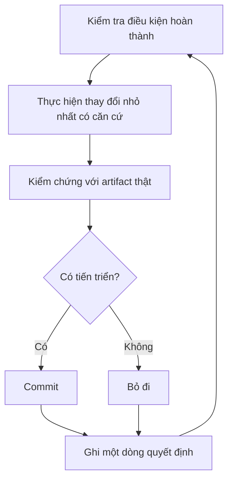

# Chạy công việc trong khi bạn ngủ

Đây là phần thưởng cho mọi thứ trước đó. Một agent bạn tin là sẽ tự kiểm chứng công việc của mình là một agent bạn có thể để lại một mình với một task khó. Điều làm việc đó an toàn không phải là hy vọng. Đó là một điều kiện hoàn thành có thể kiểm tra, một worktree hoặc cloud agent tách biệt, và một nhật ký quyết định bạn kiểm toán vào buổi sáng.


## Giành được lòng tin trước khi chạy vòng lặp

Một vòng lặp bạn không tin chỉ tạo ra công việc chưa kiểm tra nhanh hơn, và mớ hỗn độn tích lũy sau mỗi vòng. Trước khi để một vòng lặp chạy, hãy kiểm tra nó đã xứng đáng chưa:

- Bạn đã tự tay làm task này một lần, hoặc đã xem một agent làm, nên bạn biết thế nào là tốt.
- Agent có các công cụ và tín hiệu mà chính bạn sẽ dùng: verification skill, profiler, log.
- Mỗi giai đoạn chứng minh công việc của nó và có thể dừng dây chuyền khi công việc không đạt chuẩn.
- Bạn đã đọc vài transcript và biến những thất bại lặp lại thành công cụ, skill, hoặc phép kiểm tra.

Chỉ để vòng lặp tự chủ sau khi cả bốn điều trên đều đúng. Trước đó, hãy chạy nó trong khi bạn theo dõi.

## Hợp đồng qua đêm

Một lần bàn giao tốt có mục tiêu, điều kiện hoàn thành, quyền hạn, và một lối thoát. Nó không cần dài:

```text
/poteto-mode tôi đi ngủ đây. migrate mọi caller sang parser mới trong một worktree mới tách từ <base>.
xong nghĩa là không còn caller cũ nào, mọi parser fixture đều pass, api cũ đã bị xóa.
giữ một nhật ký quyết định. đừng hỏi tôi trước khi commit.
/loop đến khi xong. nếu bạn thật sự bế tắc sau vài tiếng, hãy dừng lại và viết ra lý do.
```

Xem qua mỗi dòng mang lại cho bạn điều gì:

- "tôi đi ngủ đây" là một lệnh ghi đè cho session. Agent thôi hỏi và cứ làm tiếp.
- "xong nghĩa là..." biến mục tiêu thành các phép kiểm tra mà mọi vòng lặp đều chạy được.
- "worktree mới tách từ `<base>`" giữ cho lượt chạy không va chạm với bất cứ thứ gì khác bạn đang mở.
- "đừng hỏi tôi trước khi commit" trả lời trước câu hỏi về quyền mà nếu không agent sẽ dừng lại chờ.
- `/loop` là cơ chế đánh thức có sẵn của Cursor, không phải một skill của pstack. [Playbook Autonomous run](../../skills/poteto-mode/playbooks/autonomous-run.md) dùng nó để kiểm tra lại điều kiện hoàn thành theo sự kiện hoặc theo nhịp heartbeat.
- Lối thoát cho phép nó dừng ở một ngõ cụt thật sự và viết ra lý do, điều tốt hơn tám tiếng diễn giải lại mục tiêu một cách sáng tạo.

Vì bạn sẽ review công việc này sau khi rời đi, `/poteto-mode` chuyển nó qua [`/figure-it-out`](../../skills/figure-it-out/SKILL.md), skill này thiết kế các giai đoạn của lượt chạy trước khi có bất kỳ code nào và nối vào nhật ký quyết định.

Để chủ động dừng một lượt chạy, hãy bảo agent tạm dừng, hoặc rằng bạn sắp offline hoặc khởi động lại Cursor. [Playbook Pause safely](../../skills/poteto-mode/playbooks/pause-safely.md) hoàn tất hoặc lùi khỏi bước hiện tại, commit một checkpoint đang làm dở, và viết một ghi chú để tiếp tục. Một chat mới nhận lại công việc từ ghi chú đó thông qua playbook Session pickup. Nói "cứ làm tiếp" không bao giờ kích hoạt việc tạm dừng.

## Vòng lặp làm gì suốt đêm



Một thay đổi, một phép kiểm tra, một dòng nhật ký, mỗi vòng lặp. Những thay đổi không giúp ích bị bỏ đi, không để trôi theo. Một sự chững lại nghĩa là chuyển hướng, không phải dừng, và điều kiện hoàn thành không bao giờ lặng lẽ được nới lỏng để tuyên bố chiến thắng.

## Kiểm toán buổi sáng

[`/show-me-your-work`](../../skills/show-me-your-work/SKILL.md) là thứ làm cho lượt chạy có thể review được. Mỗi dòng ghi lại thời gian, giai đoạn, quyết định, lý do, một con trỏ đến bằng chứng, và kết quả, trong một file TSV tại `decisions.tsv` (hoặc `.audit/<task-slug>.tsv` khi nhiều lượt chạy dùng chung một thư mục). Theo mặc định nó chỉ nằm cục bộ. Hãy commit nó khi công việc đủ tham vọng để reviewer cần dấu vết đó mới tin được kết quả.

Khi bạn quay lại, hãy yêu cầu lượt chạy ở dạng review:

```text
/show-me-your-work cập nhật cho tôi những gì bạn đã làm đêm qua
```

Trước khi skill trả về bản tóm tắt, nó khởi chạy một reviewer trên một họ model khác để đọc dấu vết và transcript, và câu trả lời kết thúc bằng một phần Attention liệt kê những gì đáng để bạn soi xét. Hãy đọc phần đó trước, rồi đến các dòng nhật ký mà nó trỏ tới. Bạn đang kiểm toán các quyết định, không phải đọc lại cả đêm.

Để xem nhanh trạng thái thay vì kiểm toán, hãy chạy [`/ketchup`](../../skills/ketchup/SKILL.md) trong chat đã chạy công việc. Nó chỉ đọc, và cho bạn biết bằng lời đơn giản những gì đã thay đổi kể từ tin nhắn cuối của bạn, kèm các screenshot và sơ đồ nhỏ mà công việc tạo ra. Rồi nó liệt kê từng quyết định đang chờ bạn, như một lần merge, một sự chấp thuận, hoặc một lựa chọn giữa các phương án, kèm lựa chọn của nó, bằng chứng, và rủi ro, để bạn có thể quyết định chỉ từ câu trả lời.

## Khi đêm chứa cả một hàng đợi, không chỉ một task

Hợp đồng ở trên đưa một task đến một điều kiện hoàn thành. Có những đêm chứa nhiều hơn, một hàng đợi các thay đổi độc lập hoặc cả một chương trình. Hai playbook và một skill mở rộng cùng mức lòng tin đó lên.

[Autopilot-full](../../skills/poteto-mode/playbooks/autopilot-full.md) chạy một hàng đợi các PR độc lập đến khi được merge. Mỗi PR có một agent chủ sở hữu mang nó từ lúc xây dựng đến lúc merge, và không chủ sở hữu nào merge dựa trên phán quyết của chính mình. Một swarm các verifier mới kiểm tra head đã sẵn sàng của chủ sở hữu. Một lần rebase sau đó hoặc một bản sửa nhỏ được một verifier mới kiểm tra, và chỉ hành vi mới hoặc một diff mới lớn mới gọi lại toàn bộ swarm. Chỉ một phán quyết sạch trên đúng bản vá được merge mới cho phép merge:

```text
/poteto-mode full autopilot với hàng đợi này. mỗi mục là độc lập. tôi muốn chúng được merge trước sáng mai.
```

[Autopilot-stack](../../skills/poteto-mode/playbooks/autopilot-stack.md) là Autopilot-full nhưng không merge. Bạn thức dậy với các PR đã được kiểm chứng, mỗi cái kèm phán quyết, và bạn tự review và land chúng. Một PR chỉ xếp chồng lên một PR mà nó xây dựa trên. Hãy chọn nó thay vì Autopilot-full khi bạn muốn tự mình xem công việc trước khi bất cứ thứ gì được merge:

```text
/poteto-mode autopilot năm thay đổi này, nhưng đừng merge. sáng mai tôi sẽ land chúng.
```

Cả một chương trình, như một migration trên nhiều package, không có playbook riêng. `/poteto-mode` chuyển công việc lớn hoặc cắt ngang nhiều phần sang [`/figure-it-out`](../../skills/figure-it-out/SKILL.md), skill này thiết kế một lượt chạy chặt chẽ cho nó:

```text
/poteto-mode migrate mọi package sang store mới. chịu trách nhiệm đến khi từng cái được chuyển đổi và merge. tôi sẽ ghé xem hai lần một ngày.
```

## Chạy nhiều dự án song song

Một [Cursor Project](https://cursor.com/blog/projects) cho một agent điều phối một thread lâu dài. Agent điều phối không viết code. Nó chỉ đạo các subagent, chúng chạy trên cloud theo mặc định, nên công việc vẫn tiếp tục khi laptop của bạn đã đóng. Hãy bắt đầu các prompt cho agent điều phối bằng `/poteto-mode`, và các subagent nó khởi chạy sẽ làm theo playbook. Mỗi agent nó khởi động đọc [`worker.md`](../../skills/poteto-mode/worker.md) trước, nên các worker giữ đúng tiêu chuẩn của lúc khởi động, tự quyết các lựa chọn có thể đảo ngược thay vì hỏi bạn, và mở PR sẵn sàng để review.

Vài thói quen có ích:

- Cho mỗi khối công việc một Project riêng, như một feature, một migration, một đợt đẩy perf, hoặc một lần dọn nợ kỹ thuật. Nhiều Project có thể chạy song song.
- Kéo các chat liên quan vào Project, kể cả những chat đã xong. Chúng trở thành context cho mọi agent trong đó.
- Cho mỗi PR một verification swarm trước khi merge, và để Autopilot-stack hoặc Autopilot-full mang hàng đợi.
- Yêu cầu agent điều phối một kế hoạch có dữ liệu chống lưng, và để nó trả lời các câu hỏi mở bằng prototype trước khi hỏi bạn.

Một prompt có thể mang cả một Project, từ nghiên cứu đến thực thi:

```text
/poteto-mode refactor repo này để kiến trúc của nó thân thiện với agent hơn. dùng /correct và /architect trên các commit trước và các comment review để tìm ra những lỗi agent hay mắc nhất ở đây. dùng /recall để lấy context từ các chat trước. trả lời các câu hỏi mở bằng prototype thay vì hỏi tôi. quay lại với một kế hoạch có dữ liệu thật chống lưng. khi tôi duyệt, hãy chạy nó bằng autopilot-stack hoặc autopilot-full, và hỏi tôi chọn cái nào.
```

## Để vòng lặp tự khởi động

Mọi vòng lặp ở trên vẫn chờ bạn khởi động nó. Một automation theo lịch hoặc theo sự kiện loại bỏ bước đó. Bảo trì phần mềm chia thành các giai đoạn rất hợp với điều này: phân loại một báo cáo, tái hiện nó, sửa nó, kiểm chứng bản sửa. Hai quy tắc giữ cho một dây chuyền như vậy đáng tin:

- Mỗi giai đoạn đều có thể dừng dây chuyền. Phân loại có thể kết luận báo cáo là hành vi mong đợi, tái hiện có thể không tái hiện được, và người sửa có thể đánh giá thay đổi quá rủi ro. Mỗi kết quả đó đều hữu ích, vì nó ngăn công việc tồi đến giai đoạn tiếp theo, nơi việc gỡ bỏ tốn kém hơn.
- Mỗi giai đoạn bàn giao bằng chứng. Tái hiện đính kèm screenshot và video về trạng thái lỗi, và bản sửa đính kèm bằng chứng trước và sau. Khi đó một người có thể kiểm tra agent đã sửa đúng thứ chưa trước khi đọc một dòng code.

pstack cung cấp điều này dưới dạng một [gói automation](../../automations/benny/README.md) ở trạng thái ngủ cho các báo cáo issue trên Slack. Một automation phân loại từng báo cáo. Cái còn lại tái hiện các bug đã xác nhận và có thể chuẩn bị một bản sửa nháp nhỏ. Hãy chỉ một agent vào [`FOR_AGENTS.md`](../../automations/benny/FOR_AGENTS.md) của nó và gọi tên repository đích để thiết lập.

**Cạm bẫy:** một khoảng thời gian không phải là điều kiện hoàn thành. "làm việc này trong 4 tiếng" không cho agent thứ gì để kiểm tra, và bạn sẽ thức dậy với bốn tiếng chuyển động thay vì một kết quả. Hãy đưa cho `/loop` một vị từ có thể pass hoặc fail.

Tiếp theo: [Lái bằng tên nguyên tắc](./08-principles.md).
